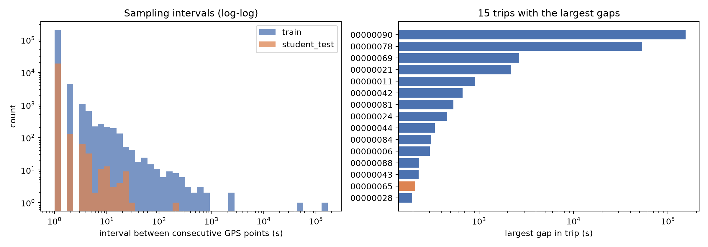
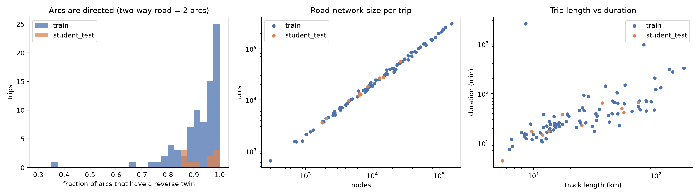
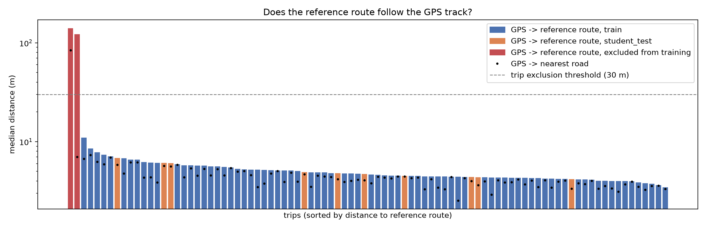

# PathSnap – Dataset Exploration and Data Quality Report

## 1. Dataset Overview

The PathSnap dataset contains two partitions:

| Partition | Number of Trips |
|---|---:|
| Training | 80 |
| Student Test | 10 |
| **Total** | **90** |

Each trip contains four files:

- `.track` – GPS observations containing longitude, latitude and timestamp.
- `.nodes` – Road-network node coordinates.
- `.arcs` – Source and destination node relationships.
- `.route` – Reference route represented by arc IDs.

The dataset contains 227,577 GPS observations across the 90 trips.

## 2. GPS Observation Analysis

| Partition | Trips | Mean GPS Points | Median | Minimum | Maximum |
|---|---:|---:|---:|---:|---:|
| Training | 80 | 2,605.21 | 1,529 | 361 | 19,313 |
| Student Test | 10 | 1,916.00 | 1,420 | 262 | 3,958 |

The mean number of GPS observations exceeds the median in both partitions, indicating variation in trip lengths and a right-skewed distribution.

## 3. Sampling Interval Analysis

Statistics are computed over all intervals in a partition (pooled), not as averages of
per-trip values. Source: `artifacts/eda/sampling_interval_summary.csv`
(`scripts/eda_checks.py`); per-trip values are in `sampling_interval_statistics.csv`.

| Metric | Training | Student Test |
|---|---:|---:|
| Number of intervals | 208,337 | 19,150 |
| Mean interval (seconds) | 2.181 | 1.057 |
| Median interval (seconds) | 1.0 | 1.0 |
| Minimum interval (seconds) | 1.0 | 1.0 |
| Maximum interval (seconds) | 153,064 | 210 |
| Intervals of exactly 1 second | 96.5 % | 98.6 % |
| Intervals over 1.5 seconds | 3.49 % (7,273) | 1.38 % (264) |
| Intervals over 60 seconds | 69 | 1 |
| Trips containing a gap over 60 seconds | 22 of 80 | 1 of 10 |

The data is nominally 1 Hz. The training mean is pulled above 1 second by a small number
of very large gaps, not by generally slower sampling:

| Trip (training) | Largest gap | Note |
|---|---:|---|
| 00000090 | 153,064 s (about 42.5 hours) | 536 points over 8.6 km; consistent with a recording that was paused and resumed |
| 00000078 | 52,810 s (about 14.7 hours) | same pattern |
| 00000069 | 2,658 s | |
| 00000021 | 2,161 s | |

The largest student-test gap is 210 seconds (trip 00000065). Such gaps matter for
modelling: speed and heading computed across a gap are meaningless, and a sequential
decoder must not assume that consecutive observations are one second apart.

No negative or zero timestamp differences were detected.

## 4. Data Quality Assessment

The following checks were performed on GPS observations:

- Missing longitude, latitude and timestamp values.
- Longitude and latitude values outside valid geographic ranges.
- Zero or negative timestamps.
- Duplicate GPS rows.

No occurrences of these issues were detected in either partition.

| Data Quality Check | Training | Student Test |
|---|---:|---:|
| Missing longitude | 0 | 0 |
| Missing latitude | 0 | 0 |
| Missing timestamp | 0 | 0 |
| Invalid longitude | 0 | 0 |
| Invalid latitude | 0 | 0 |
| Zero/negative timestamps | 0 | 0 |
| Duplicate GPS rows | 0 | 0 |

These checks cover the GPS files in isolation. They do not establish that the data is
free of problems: the more serious issues are found when the GPS track is compared with
the road network and the reference route (sections 6 and 7).

## 5. Road Network Analysis

| Metric | Training | Student Test |
|---|---:|---:|
| Average nodes per trip | 24,168.56 | 9,068.90 |
| Average arcs per trip | 48,461.30 | 18,504.10 |
| Average connected components | 39.01 | 22.70 |
| Average isolated nodes | 0 | 0 |

Road-network analysis was performed using NetworkX and an undirected graph representation.

All source and target node references in the `.arcs` files were validated against the corresponding `.nodes` files. No invalid references were detected.

### 5.1 Arcs are directed

The arcs are directed (`from_node -> to_node`), which the undirected analysis above
hides. Source: `artifacts/eda/arc_direction.csv`.

- In the median trip, 95.1 % of arcs have a reverse twin (an arc with the same two
  nodes in the opposite order). A two-way road is therefore stored as **two arcs with
  identical geometry**, and a one-way road as a single arc.
- The share varies: 26 of the 90 trips are below 90 %, and trip 00000080 has only 35 %
  twin arcs (a network dominated by one-way segments).
- Treated as a directed graph, the networks have on average 37 weakly connected and 234
  strongly connected components per trip, so not every arc can be reached from every
  other arc by legal driving.
- The median arc length is about 25 m, comparable to GPS noise.

Consequence for modelling: for a point on a two-way road, both twin arcs are exactly
the same distance away, so distance alone cannot identify the correct arc. Direction of
travel is required.

## 6. Geographic Coverage

| Metric | Training | Student Test |
|---|---:|---:|
| Mean longitude range | 0.1873° | 0.1500° |
| Mean latitude range | 0.1078° | 0.0831° |
| Maximum longitude range | 1.1039° | 0.7150° |
| Maximum latitude range | 0.6781° | 0.2412° |

Training trips show greater average geographic spread than student-test trips.

### 6.1 Extent in metres

Degrees are not a distance: one degree of longitude is about 111 km at the equator and
about 62 km at latitude 56°. Each trip was therefore projected into the UTM zone of its
own centroid (25 different zones across the 90 trips) and all distances are measured in
metres. Within a city-sized area UTM distortion is below 0.1 %, far smaller than GPS
noise. Source: `artifacts/eda/trip_extent_metric.csv`.

| Metric | Training | Student Test |
|---|---:|---:|
| Median bounding box (km) | 7.6 × 5.3 | 5.3 × 5.9 |
| Largest bounding box side (km) | 75.1 | 45.0 |
| Median track length (km) | 24.1 | 21.0 |
| Longest track (km) | 169.6 | 71.8 |
| Median duration (minutes) | 28.5 | 30.2 |

The trips cover different geographic regions, so individual trip visualisations are more meaningful than plotting all trajectories as a single local route.

## 7. Reference Routes

### 7.1 Validity and continuity (all 90 trips)

Source: `artifacts/eda/route_validation.csv`.

- Every route arc ID is a valid zero-based row index into the trip's `.arcs` file.
- Routes are almost, but not perfectly, continuous. Of all consecutive route steps, 14
  do not connect (the `to` node of one arc is not the `from` node of the next), spread
  over 11 trips: 00000002, 00000019 (3 steps), 00000033, 00000041, 00000042, 00000069,
  00000075 (2 steps), 00000080, 00000086, 00000089 in training and 00000076 in
  student-test.
- 10 trips traverse the same arc more than once.

### 7.2 Does the reference route follow the GPS track?

For every GPS point, the distance to the nearest road arc and the distance to the
reference route were measured in metres. Source: `artifacts/eda/route_gps_agreement.csv`.

For 88 of the 90 trips the median distance from a GPS point to its reference route is
between 3 and 11 m, consistent with GPS noise. Two training trips are anomalous:

| Trip | GPS to nearest road (median) | GPS to reference route (median) | Points over 50 m from the route | Interpretation |
|---|---:|---:|---:|---|
| 00000054 | 84 m | 140 m | 89 % | The GPS track is offset from the whole road network |
| 00000033 | 7 m | 122 m | 59 % | The GPS is on roads, but the reference route does not follow it |

Decision: a point's reference label is treated as unreliable when it is more than 50 m
from its reference arc, and a trip is excluded from training and tuning when its median
exceeds 30 m. This excludes trips 00000033 and 00000054. In student-test, 0.14 % of
points are flagged and no trip is excluded. The reference routes are treated as
reference information, not as verified ground truth.

## 8. Methodology and Assumptions

1. GPS files were interpreted as longitude, latitude and timestamp columns.
2. Road-network node files were interpreted as longitude and latitude columns.
3. Arc files were interpreted as source-node and destination-node IDs.
4. Route IDs were validated as zero-based row indices into the corresponding arc file for the inspected trip.
5. Connected components were calculated using undirected NetworkX graphs.
6. Timestamp gaps greater than 1.5 seconds were flagged for exploratory analysis. This threshold is not a confirmed dataset rule.
7. Road-network map visualisations use sampled segments for display efficiency; the original network files remain unchanged.
8. The student-test partition was inspected for dataset inventory and quality assessment only and was not used for model training or tuning.
9. Distances and extents in metres use a per-trip UTM projection.
10. Sections 5.1, 6.1 and 7 are produced by `scripts/eda_checks.py`.

## 9. Conclusion

The dataset inventory confirms 90 complete trip folders with four expected files per trip. The GPS quality checks found no missing values, invalid geographic coordinates, non-positive timestamps or duplicate GPS observations.

The GPS files are clean in isolation, but the dataset is not free of problems:

- Sampling is 1 Hz for 96 to 99 % of intervals, with gaps of up to 42.5 hours in training.
- Arcs are directed and two-way roads are duplicated as twin arcs, so the nearest arc is
  ambiguous without direction of travel.
- Reference routes have 14 disconnected steps across 11 trips.
- Two training trips (00000033, 00000054) have reference routes that do not match their
  GPS tracks and are excluded from training.

The analysis also identified variable trip lengths, differences in road-network size and geographic coverage between partitions.

These findings provide an exploratory foundation for subsequent PathSnap route modelling and visualisation.
